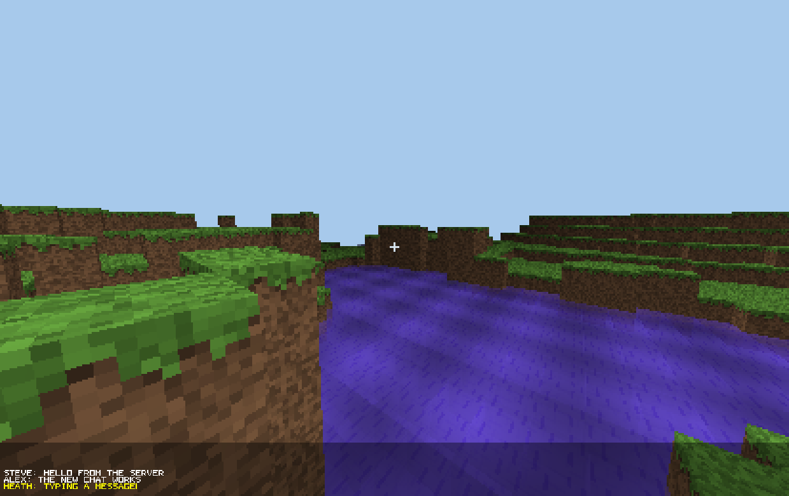

# ClassicCraft
A voxel game with an 80's look. The world is rendered by a per-pixel CPU raycaster,
with an optional fragment-shader GPU backend.

## Relationship to Retro Craft

ClassicCraft is a fork of [Retro Craft](https://github.com/HeathLoganCampbell/Retro-Craft).

Retro Craft's defining constraint was **no libraries**: the renderer is hand-written on
the CPU and the only dependency is the JDK (see
[ADR 0002](docs/adr/0002-pure-java-software-renderer.md)). ClassicCraft keeps that
constraint for the CPU renderer, because that code is the explanation of how rendering
works, but it does **not** apply it to the project as a whole.

**Graphics libraries are allowed here.** The optional GPU backend uses LWJGL 3
(GLFW + OpenGL), and future rendering work is free to use whatever library fits. The CPU
path stays dependency-free and is kept as the reference implementation.

[](https://www.youtube.com/watch?v=m63pDKehByg)

[Youtube video of Retro Craft](https://www.youtube.com/watch?v=m63pDKehByg)

## How to install
Build from source (Java 18+ and Maven):

```bash
mvn package
./run-gpu.sh          # GPU renderer; Maven pulls in LWJGL
```

ClassicCraft v1.1 is source-only for now. The last Retro Craft binary (v0.4.5, CPU
renderer) is still on the
[Retro Craft releases page](https://github.com/HeathLoganCampbell/Retro-Craft/releases).

## How to play
```
W = forwards
S = backwards
A = left
D = right
left mouse button = break block
right mouse button = place block
right arrow key = changed block placed 
```

## GPU renderer (v1.0)

The world renderer can also run on the GPU. It is the same raycaster, ported to
a fragment shader: the 64x64x64 block array becomes a 256 KB `R8UI` 3D texture,
`World.render()` becomes `shaders/raycast.frag`, and the result is drawn at
413x260 and nearest-upscaled to 1239x780. `Main.FOCAL` scales with the
resolution, so the field of view is unchanged; only the detail increases.

The CPU renderer is untouched and remains the reference implementation; this is
an optional backend, not a replacement.

```bash
./run-gpu.sh                 # play, natural terrain
./run-gpu.sh --flat          # the old flat world
./run-gpu.sh --tps 120       # simulation rate (default 60, independent of fps)
./run-gpu.sh --speed 1.0     # movement multiplier (default 2.0)
./run-gpu.sh --max-fps 500   # uncap vsync and target 500 fps
./run-gpu.sh --server 127.0.0.1 --name HEATH   # join a server (chat + block sync)
CLASSICCRAFT_USERNAME=HEATH ./run-gpu.sh --server 127.0.0.1   # name from the environment
./run-gpu.sh --selftest 120  # render offscreen, write gpu-frame.png, print timings
```

Controls are the same as the CPU client. `Esc` quits, `F2` toggles the debug
window title, left/right arrows cycle the block type (and turn, matching the
old key handling).

The player name comes from `--name`, otherwise `CLASSICCRAFT_USERNAME`, otherwise
`Player`.

Chat: `T` (or `/`) opens the input line, `Enter` sends, `Esc` cancels. Messages
support Minecraft-style codes: `&0`-`&f` colours, `&l` bold, `&r` reset
(for example `&cRED &lBOLD`). Run the
server with `./run-server.sh` first; clients join with `--server`. If no server
is reachable the game stays single-player and chat lines stay local.

Water is drawn as a tinted, animated surface: rays continue through water and
blend the bottom, so shallow water shows the floor instead of hiding it.

Requires LWJGL 3 and a GPU with OpenGL 3.3+; on macOS the script passes
`-XstartOnFirstThread`. Measured on an M1 Pro through Metal-backed OpenGL 4.1:
**0.58 ms/frame** at 413x260 (~1,700 fps serialised).

The simulation runs at a fixed **60 ticks/second**, decoupled from the display, and
movement is compensated for the tick rate so `--tps` changes smoothness, not speed.
`--speed` changes speed (default 2.0). See [ADR 0016](docs/adr/0016-gpu-raycast-backend.md).

Known limitations in v1.0: player sprites (the depth attachment is ready), the debug
overlay and networking are not ported to the GPU client yet.

## Server plugins

`RetroCraftServer` registers `ServerPlugin`s and calls `onPlayerJoin(Player)` for each
connection. The built-in `WelcomePlugin` sends `&bWelcome to the server` to the joining
player. Add one by implementing `ServerPlugin` and registering it in `RetroCraftServer`.

## Tests

```bash
mvn test
```

The suite is JUnit 5 and covers the shared simulation and network layers: world access
and generation, the block registry and behaviour, raycasting, player physics and
interaction, packet registry/round-trips/pipeline, and bitmap assets (102 tests).

The GPU renderer is checked separately with `./run-gpu.sh --selftest` (frame time and
`gpu-frame.png`); `--chat-demo` and `--water-demo` render the overlay and shallow-water
scenes for inspection.

## Development

### Things to add
* Entities
* Multiplayer support
* Fix mouse issue for windows
* make ticks more consistent
* Break up the Minecraft class so it's more understandable
* Title screen
* Chunkize the world
* Make particles
* Generate trees
* Make it so you swim in lava
* Make it so Bigger Y = higher up

## Versions

### v0.1.5
[It's just a bad version of minecraft, example](https://gyazo.com/d123022c618a0574954187d86f35e100)

### v0.2.0
[Example](https://gyazo.com/3a32f4017e7bda57560eb9ce96a4ce16)

### v0.2.1

* Added the ability to change different block types
* Fix grass spawning throughout all dirt blocks

Issues still around
* windows doesn't set the location of the mouse correctly

### v0.3.0

* Add TNT that explodes in a chain
* Add glass
* String rendering engine
* added cross hair

### v0.4.0

* Water that flows
* lava that flows

### v0.4.5

* water is now naturally generated in the land
* there is a preview of what block you'll place

### Renamed to Retro Craft
Because it sounded better

### v0.5.0 [2/11/2022]

* Added sprites
* Add Multiplayer abilities
* remove mouse control
* Move project to use Maven

### v1.0: ClassicCraft [20/10/2026]
* Forked from Retro Craft and renamed ClassicCraft
* Graphics libraries are allowed: the optional GPU backend uses LWJGL 3 + OpenGL
* The world raycaster runs as a fragment shader, at 0.36-0.52 ms/frame (318x200)
* Simulation runs at a fixed 60 ticks/s, decoupled from the frame rate (`--tps`, `--speed`)
* Fixed the CPU renderer's per-frame fog/sky leak
* World tick no longer allocates for all 262,144 blocks every tick

### v1.1 [20/10/2026]

* Internal resolution raised 30%, to 413x260 with the same field of view
* Transparent, animated water (the floor is visible through shallow water)
* Chat: `T` to talk, server broadcast, bitmap font, and `&0`-`&f` / `&l` colour codes
* Movement decoupled from the frame rate: fixed 60 ticks/s, `--tps`/`--speed`
* Air movement reworked: jumps can be steered instead of feeling ballistic
* Placement is refused inside the player; jump to place underneath yourself
* Block break/place restored on the GPU path, with the targeted block outlined
* `--max-fps` for 500+ fps, and a fixed 20 TPS server
* 102 JUnit 5 tests over the shared simulation and network layers
